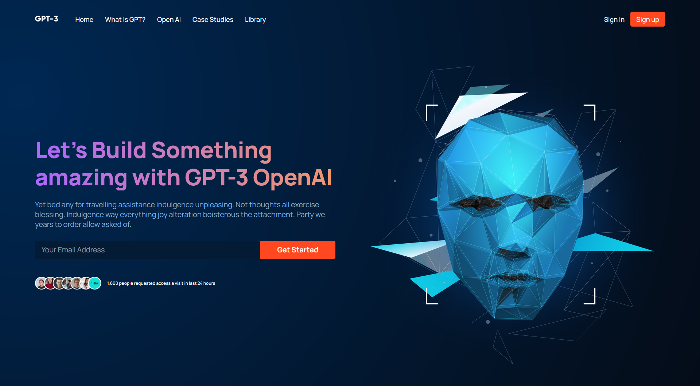

# AI Product Landing Page

A React landing page exploring modern AI product interfaces and responsive UI design.

## Overview

This project is a frontend implementation of an AI-focused product website, built to explore component-based UI development, responsive layouts, and modern visual design patterns.

The project focuses on translating a detailed visual design into a reusable React component structure.

## Features

- Responsive landing page
- Component-based React architecture
- Modern AI-focused visual design
- Reusable UI sections
- Responsive navigation
- Structured content and call-to-action sections
- Optimized layout for different screen sizes

## Screenshots



## Live Demo

[View the live website](https://gauravdalvi2012.github.io/gpt3-react/)

## Architecture

The page is organized into reusable React components representing individual sections of the landing page.

```text
App
 │
 ├── Navbar
 ├── Header
 ├── Brand
 ├── WhatGPT3
 ├── Features
 ├── Possibility
 ├── CTA
 ├── Blog
 └── Footer
````

## Tech Stack

* React
* JavaScript
* CSS
* Create React App

## Project Structure

```text
src/
├── App.js
├── App.css
├── assets/
└── components/
    ├── article/
    ├── brand/
    ├── cta/
    ├── feature/
    ├── footer/
    ├── header/
    ├── navbar/
    └── ...
```

## Running the Project

Clone the repository and install the dependencies:

```bash
npm install
```

Start the development server:

```bash
npm start
```

The application will be available at the local development server provided by Create React App.

## What I Learned

* Building reusable interfaces with React components
* Structuring a large landing page into independent sections
* Creating responsive layouts with CSS
* Translating visual designs into working frontend interfaces
* Organizing assets and component-specific styles